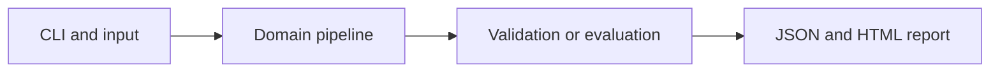

# Condition-Preserving Metabolomics Batch Correction

Estimate technical batch offsets while retaining a fictional biological condition effect.

**Category:** Biology / ML Preprocessing

**Execution:** Actual local algorithm or workflow; no external model service required.

## Run

```sh
python -m venv .venv
# Windows: .venv\Scripts\activate
# macOS/Linux: source .venv/bin/activate
python -m pip install -r requirements.txt
python app.py
python -m unittest discover -v
```

Open `results/report.html` after running. Python 3.10+ is required. Use `--help` for input and seed options.

## Architecture



## Algorithm

Fit each feature against intercept, condition and batch indicators on training samples. Subtract only fitted batch offsets. Preserve the condition component rather than centering entire groups indiscriminately.

## Evaluation

Use held-out samples from known batches and compare estimated technical-effect removal with naive centering. Hidden clean profiles are available only because the data is synthetic.

## Limitations

Condition labels are used for fitting training batch effects; test condition labels are not used by correction. New unseen batches and confounded batch-condition designs need separate treatment.

## Documentation

- [PDF project guide](PROJECT_GUIDE.pdf)
- [Editable guide](GUIDE.md)
- [Model and system card](MODEL_CARD.md)
- [Measured results](results/metrics.json)
- [Test output](TEST_RESULTS.txt)

## Extend it

Check design identifiability, evaluate biological signal preservation, include pooled controls and compare established methods on a licensed metabolomics dataset.

AI-assisted educational project with synthetic data. Review, customize and explain your own contribution accurately. MIT license.

## Biology scope and current relevance

Default inputs are synthetic or project-authored. No clinical deployment or wet-lab validation is claimed. See [research context](RESEARCH_CONTEXT.md) and [data provenance](DATA_PROVENANCE.md).

- [Robust metabolomics normalization across experimental designs](https://pubs.acs.org/doi/10.1021/acs.analchem.5c06841) (2026)
